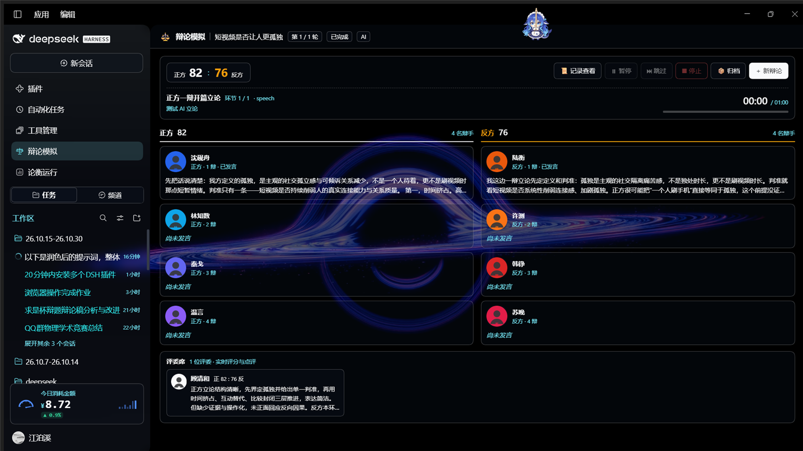

# 辩论模拟（DSH 插件）

在 DeepSeek Harness 里跑一场可回放、可归档的多智能体辩论模拟：管理员调度讨论 → 8 名辩手串行发言 → 评委逐环节计分 → 教练总结 → 每轮 ZIP 归档 → 最后一轮 Word 汇总。

入口是侧边栏模块「辩论模拟」，与「插件管理」「自动化任务」「工具管理」并列。



## 功能

- **讨论阶段**：正反两栏实时刷新，自由讨论直到计时结束；讨论期间不产生发言气泡。
- **稿子预写**：讨论阶段先写一辩陈词、二辩问题链+小结、三辩问题链+小结、四辩总结，进入辩论时供对应辩手使用。
- **辩论阶段**：左正方 / 右反方 / 下评委；8 名辩手使用位置称呼（正方一辩…），严格串行，单气泡展示。
- **思考层**：每次发言前生成「💭 内心」判断，与正式台词分开展示；不进入对手可读的交锋记录。
- **计时**：真实逐秒；陈词/小结说完即结束；质询/盘问只走计时方，回答方时钟暂停。
- **计分板与记录**：评委实时打分、可回看全部发言与思考。
- **训练方**：选正方/反方后可设结束条件——训练方胜率超过阈值提前收官，或固定轮次跑满（1–100）；两项都在「高级」里，与训练方同菜单。
- **训练方备赛包**：额外生成 Markdown + Word，含原文（全部轮次/环节/每条发言）、方法、缺点、提升建议、最终稿、可能应对。
- **自定义赛制**：赛制菜单下可逐环节勾选 + 修改时间（15 项：14 环节 + 节奏）；高级里保留 JSON 版。
- **模型**：默认 `deepseek-account / deepseek-flash`；可改模型、思考强度，或填 OpenAI 兼容的 API 地址 + 密钥。
- **提示词 JSON**：支持全局辩手/评委/教练补充，也可按 `pro-1`…`con-4`、`judge-1`、`coach-pro` 单人微调。
- **可靠性**：每轮 ZIP 后清理临时目录与智能体；`state.json` 断点恢复；所有产物命名可追溯。

## 安装

前置：DSH 桌面/Web 版，Node `^22.19.0 || >=24.0.0`。插件无第三方运行时依赖。

在 DSH 会话里调用：

```text
plugin_manager
  action: install_bundle
  target: C:\project\python\26.10.15-26.10.30\debate-sim
```

安装后刷新 Web GUI。左侧边栏「工具管理」下方出现「辩论模拟」。

也可以用打包产物安装：

```bash
pnpm pack
# 然后在 DSH 里 install_bundle 指向生成的 .tgz
```

## 使用

1. 打开侧边栏「辩论模拟」。
2. 填辩题；按需展开「赛制 / 模型 / 高级」。
3. 点「开始辩论」。
4. 讨论阶段看两栏实时讨论与草稿纸；辩论阶段看气泡、思考层、计分板。
5. 结束后在「归档」下载每轮 ZIP、最终 Word、训练方备赛包。

### 参数

| 参数 | 默认 | 说明 |
| --- | --- | --- |
| 轮次 | 3 | 1–100；训练模式按结束条件提前收官 |
| 气泡秒数 | 10 | 1–120 |
| 讨论分钟 | 3 | 0.5–30 |
| 评委数 | 1 | 1–3 |
| 节奏 | 2 | 1–60，压缩讨论阶段墙钟 |
| 训练方 | 无 | 无 / 正方 / 反方 |
| 训练结束条件 | 胜率超过阈值 | 胜率超过阈值 / 固定轮次跑满 |
| 胜率阈值 | 50 | 1–100；按已完成轮次累计，严格超过才收官，100 = 不提前结束 |
| 模型服务 | deepseek-account | provider |
| 模型 | deepseek-flash | model id |
| 思考强度 | high | low / medium / high |
| API 地址 | 空 | OpenAI 兼容 `/v1`；与密钥同时填才启用 |
| API 密钥 | 空 | 仅本次运行内存使用，不写入归档 |

## 产物目录

默认在工作区 `debate-runs/<runId>/`：

```text
run.json
state.json
rounds-index.json
第01轮_辩论归档.zip
全部轮次汇总.md
辩论模拟总结_<slug>.docx
训练方备赛包_正方.md / .docx   （开启训练方时）
```

每轮 ZIP 内含：管理员评论、正方/反方目录（草稿纸、讨论记录、发言记录、分析材料、总结）、评委记录、计分板、README。

## Agent 工具

`debate_simulation`：

```json
{"action":"start","topic":"...","config":{"rounds":2,"trainingSide":"pro"}}
```

`action` 支持 `start / status / records / pause / resume / skip / stop`。

## 开发与测试

```bash
cd debate-sim
node --test
```

27 个用例覆盖赛制、ZIP/DOCX、权限隔离、串行调度、归档清理与恢复。

- `lib/host/`：引擎、存储、归档、提示词与模拟器
- `client.js`：侧边栏图标 + 主栏模块页
- `docs/CONTRACT.md`：模块契约
- `docs/USER-GUIDE.md`：3 分钟上手

## 常见问题

- **侧边栏没有入口**：确认插件已启用并刷新页面。
- **一直回退演示文本**：检查模型服务/模型/密钥；自定义 API 需填地址与密钥。
- **讨论很久**：讨论会一直持续到计时结束；可用「跳过」。
- **想重跑**：点「新辩论」或重新开始，会先停止未完成的 run。

## License

MIT
